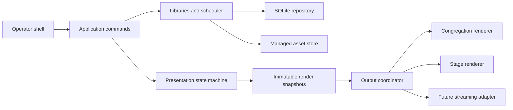

# Proposed system architecture

Original design; no claim about EasyWorship internals.

## Module boundaries
| Module | Owns | Boundary and failure policy |
|---|---|---|
| Shell | navigation, dialogs, focus, layout | commands only; never edits live renderer state |
| Presentation engine | preview/live snapshots and guards | pure reducers; deterministic versioned commands |
| Renderer/theme engine | layout, composition, transitions | consumes snapshot plus surface metrics; bounded resources |
| Display manager | enumeration, assignment, hot-plug | platform interface; reports loss without blocking UI |
| Song/Bible/search libraries | indexed content and rights metadata | transactional repositories; cancellable queries |
| Media/audio/video | probing, decode, playback and audio ownership | platform adapter; bounded queues and structured errors |
| Scheduler | ordered item references and revisions | resolves take snapshot; edits never mutate active snapshot |
| Import/export | validation, format version, deduplication | stage first; atomic commit; reject unsafe archive paths |
| Settings | preferences, themes and output profiles | versioned defaults; invalid display assignment fails safe |
| Backup/recovery | consistent snapshots and restoration | validate before replacement; retain previous valid state |
| Diagnostics | rotating logs and health events | avoid lyric/media content and credentials by default |

Domain core depends on no UI or native rendering package. Application services depend on interfaces; platform infrastructure implements them. UI dispatcher handles only bounded work. Database writes use a serialized writer; reads and file probing run off the dispatcher. Native resources have explicit ownership and cancellation. Decoder failure should not crash the shell; evaluate process isolation for untrusted media during reliability phase.

Runtime is offline by default after licensed content installation. Optional integrations must not gate startup or local presentation. Installation/update downloads are distinct from runtime network requirements.
